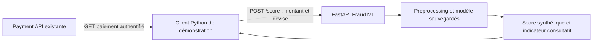

# Fraud Detection ML — Plan final du projet secondaire

**Date :** 29 octobre 2026 — Europe/Paris  
**Statut :** protocole validé et trois milestones vérifiés localement. Voir `docs/M3_VERIFICATION.md` et `docs/M3_LOCAL_DEMO.md` pour les preuves du 29 octobre 2026, `reviews/GLOBAL_REVIEW.md` pour la review globale et [la PR M3](https://github.com/WYLLLY/fraud-detection-ml-service/pull/3) pour son état d’intégration GitHub. Les paramètres expérimentaux ci-dessous restent inchangés.
**Workspace :** `/Users/william/Documents/Projet 3`  
**Projet associé :** Payment & Ledger, `/Users/william/Documents/Projet 1`

Ce document remplace intégralement le précédent plan F0–F7. Le projet comporte désormais **trois milestones**, réalisés et validés successivement. Les paramètres ci-dessous constituent les choix par défaut de la première expérience ; ils seront versionnés, sans ajustement opportuniste pour favoriser un modèle.

## 1. Objectif, architecture et limites

Construire un petit projet Python démontrant quatre compétences : génération de données synthétiques documentées, comparaison scikit-learn/PyTorch, inférence FastAPI et consommation des données d’une API existante.

Le modèle apprend des labels artificiels tirés selon une règle probabiliste. Ses résultats mesurent l’apprentissage de cette simulation, **pas la détection de fraude réelle**. Le service peut scorer les caractéristiques compatibles d’un paiement existant ; ce paiement n’a pas de label synthétique connu, donc la démonstration ne permet pas d’affirmer que sa prédiction est correcte.



### Contrat existant vérifié

Dans Projet 1, [PaymentResponse](</Users/william/Documents/Projet 1/src/payment_ledger/payments/schemas.py:18>) expose notamment `id`, `amount_minor`, `currency`, `created_at` et `state`. Le [GET /payments/{payment_id}](</Users/william/Documents/Projet 1/src/payment_ledger/api.py:207>) authentifie l’utilisateur et vérifie la propriété du paiement.

Les devises supportées sont EUR, USD et JPY. Les montants sont des entiers stricts en unités mineures, entre 1 et `1_000_000_000_000`. Le MVP utilise uniquement **`amount_minor` et `currency`**. L’heure, les UUID, le destinataire et l’état du paiement sont exclus des features. `created_at` existe, mais n’est pas nécessaire à cette première expérience.

Source vérifiée au commit `22e5fdb6709d40fc17afe697b90eeac52e086edc`. Le fichier non suivi `reviews/architecture-plan-review.md` préexistait et reste intact. Lors de l’audit précédent, 317 tests ont été collectés sans exécution : ce n’est pas une preuve de réussite actuelle de la suite.

### Périmètre strict

- Repository et environnement Python indépendants dans Projet 3.
- **Aucun changement de code, migration, configuration ou contrat dans Projet 1.**
- Aucun accès du service ML à PostgreSQL, au ledger ou au fournisseur de paiement.
- Aucun paiement créé, modifié, bloqué ou rejoué par le client de démonstration.
- Aucun worker durable, queue, ordonnanceur, base supplémentaire, frontend ou plateforme MLOps.
- Pas de dataset public ULB dans le MVP : ses features ne correspondent pas à cette API.
- Aucun entraînement, téléchargement ou remplacement de modèle pendant une requête.
- Déploiement local uniquement ; aucune exposition publique ou décision financière automatique.

### Stack retenue

Python **3.12**, uv et lockfile ; NumPy/pandas ; scikit-learn ; PyTorch CPU ; FastAPI/Pydantic ; HTTPX pour le client ; pytest ; Ruff ; **Pyright (mode strict)** ; Docker ; GitHub Actions.

Mise à jour des consignes agents : la demande utilisateur impose désormais Pyright à la place de mypy ; les autres choix du plan restent inchangés.

Les versions exactes sont résolues et figées dans le lockfile de M1, puis conservées entre entraînement et inférence. La compatibilité est vérifiée sur le poste de développement et dans l’image Linux CPU. Pas de GPU requis, pas de matrice de versions exhaustive. L’environnement Python 3.14 du projet de paiement reste indépendant.

## 2. M1 — Données, apprentissage et comparaison

**Objectif :** entraîner réellement les deux familles de modèles et produire une comparaison reproductible, honnête et explicable.

### 2.1 Générateur synthétique v1

Générer **60 000 observations indépendantes** avec NumPy `default_rng`, seed de génération **42**. Une observation contient un identifiant de ligne pour les partitions, le montant, la devise et le label. L’identifiant n’entre jamais dans le modèle.

Les devises sont tirées uniformément. Les échelles synthétiques, exprimées en unités mineures, sont :

| Devise | Échelle `s` | Domaine accepté `[0,05 × s ; 50 × s]` |
| --- | ---: | ---: |
| EUR | 10 000 | 500 à 500 000 |
| USD | 12 000 | 600 à 600 000 |
| JPY | 15 000 | 750 à 750 000 |

Ces échelles sont **des paramètres pédagogiques arbitraires**, pas des taux de change ni une estimation de comportements réels. Une unité mineure vaut un centime pour EUR/USD et un yen pour JPY ; aucune conversion universelle `/100` et aucune conversion entre devises ne sont utilisées.

Pour chaque ligne :

1. Tirer `u` selon une loi normale de moyenne 0 et écart-type 1,1, par rejet hors de `[ln(0,05), ln(50)]`.
2. Calculer `amount_minor = round(s × exp(u))`, comme entier, borné au domaine indiqué.
3. Recalculer `x = ln(amount_minor / s)` à partir du montant arrondi.
4. Définir la probabilité synthétique :

```text
sigmoid(z) = 1 / (1 + exp(-z))
p(x) = 0.01
     + 0.15 × sigmoid(2 × (x - 1.5))
     + 0.04 × exp(-0.5 × ((x - 0.2) / 0.35)²)
y ~ Bernoulli(p(x))
```

Cette règle crée un risque de fond, un effet progressif des montants élevés et une variation locale non linéaire. Les tirages Bernoulli produisent un recouvrement entre les classes : un montant élevé n’implique pas systématiquement un label positif.

La prévalence sera de l’ordre de quelques pour cent et sera **mesurée**, pas forcée par rééquilibrage. Le rapport publie les proportions globales et par devise. Ne pas retoucher la règle après comparaison pour améliorer les métriques ou faire gagner PyTorch.

La probabilité `p(x)` est conservée dans un fichier de référence distinct, joint par identifiant uniquement pendant l’évaluation. Elle ne figure ni dans les features, ni dans le preprocessing, ni dans les requêtes d’inférence. L’inférence n’importe pas le générateur.

### 2.2 Partitions et preprocessing

- Partitionner les identifiants en **70 % train / 15 % validation / 15 % test**, avec stratification par label et seed **43**. Sauvegarder les identifiants des partitions.
- Le split aléatoire est adapté à ce générateur indépendant sans chronologie. Ne pas revendiquer une validation temporelle ou une généralisation à de futurs paiements réels.
- Vérifier que les identifiants sont disjoints. Deux tirages indépendants ayant les mêmes montant/devise restent légitimes ; ils ne doivent pas être confondus avec la duplication d’une ligne entre partitions.
- Exiger la présence des deux classes et au moins 50 positifs par partition pour l’expérience complète. Un échec déclenche un diagnostic, pas une recherche de seed donnant de meilleurs résultats.
- Transformer le montant par `log1p(amount_minor)`, puis standardisation ajustée sur train uniquement.
- Encoder la devise en one-hot avec ordre fixe EUR, USD, JPY, sans catégorie supprimée. Le modèle reçoit donc **quatre entrées**.
- Même transformation et même ordre pour les deux modèles et pour l’API. Aucun SMOTE, suréchantillonnage ou pondération des classes dans cette première expérience.

### 2.3 Modèles et références

| Candidat | Configuration v1 |
| --- | --- |
| Référence constante | Probabilité égale à la prévalence du train, via `DummyClassifier(strategy="prior")` |
| Baseline scikit-learn | Régression logistique, `C=1`, `max_iter=1000`, sans pondération de classes ; convergence contrôlée |
| MLP PyTorch | `nn.Module`, architecture **4 → 16 → 8 → 1**, ReLU entre couches, sortie logit ; sans dropout |
| Référence du générateur | Probabilité exacte `p(x)`, disponible uniquement dans le rapport expérimental |

Pour le MLP : `BCEWithLogitsLoss`, Adam, learning rate `1e-3`, batches de 256, maximum 50 epochs, early stopping après 5 epochs sans amélioration d’AP sur validation. Seed d’entraînement **44**, sauvegarde effective du meilleur checkpoint. Inférence avec `eval()` et sans calcul de gradients.

Pas de recherche exhaustive d’hyperparamètres et pas d’architecture supplémentaire. Les deux modèles sont entraînés même si la baseline gagne. La référence du générateur montre ce qui est prévisible dans la simulation ; elle n’est pas un modèle appris, n’est pas déployée et ne prédit pas parfaitement les tirages Bernoulli individuels.

### 2.4 Sélection, seuil et rapport

Choisir le modèle sur **AP de validation**. Retenir le MLP seulement si son AP dépasse celle de la régression logistique de plus de **0,01 en valeur absolue** ; sinon conserver la baseline plus simple. Cette marge est une règle de sélection pratique, pas un test de significativité.

Choisir séparément le seuil de chaque modèle appris en maximisant F1 sur validation, parmi ses scores distincts. En cas d’égalité, retenir la meilleure précision, puis le seuil le plus élevé. La prédiction positive est `score >= seuil`. Seul le modèle retenu est chargé par l’API.

Après sélection et gel des modèles/seuils, évaluer les deux candidats sur le test final. Ne pas changer de modèle ou réajuster le seuil selon ces résultats. Un résultat insuffisant reste un résultat documenté ; toute nouvelle expérience est explicitement versionnée.

Le rapport présente :

- Nombre de lignes, positifs, prévalence, partitions et configuration.
- Precision, recall, F1 et matrice de confusion aux seuils 0,5 et sélectionné.
- **Average precision (AP)**, métrique principale de classement, et courbe précision-rappel. Rapporter également la PR-AUC trapézoïdale sous son propre nom : elle ne doit pas être assimilée à AP. [Définition scikit-learn](https://scikit-learn.org/stable/modules/generated/sklearn.metrics.average_precision_score.html).
- Brier score, log loss et diagramme de calibration avec 10 groupes de quantiles et leurs effectifs. Pas de recalibration supplémentaire dans le MVP. Brier seul ne prouve pas une bonne calibration. [Référence scikit-learn](https://scikit-learn.org/stable/modules/calibration.html).
- Comparaison de ces métriques sans seuil avec la référence constante et `p(x)`, sur les mêmes lignes de test.
- Temps d’entraînement et latence d’inférence CPU, accompagnés du matériel utilisé ; aucun SLO de production revendiqué.
- Limites : deux variables, données artificielles, résultat dépendant du générateur, absence de validation sur des fraudes réelles.

Une métrique indéfinie est signalée avec sa cause, jamais présentée comme une mesure valide. Aucun objectif arbitraire de précision ou de recall n’est imposé. Si le modèle retenu ne dépasse pas la référence constante en AP de validation, terminer le diagnostic et le rapport, mais ne pas le promouvoir automatiquement en M2.

### 2.5 Artefact sauvegardé

Un bundle local versionné contient : modèle retenu, preprocessing, seuil, ordre et schéma des features, domaines autorisés, configuration du générateur, seeds, hash du dataset et des partitions, hash du lockfile, métriques et SHA-256 des fichiers. La version est un identifiant dérivé du manifeste, sans alias mutable `latest`.

Pour scikit-learn, sauvegarder le pipeline avec joblib ; charger exclusivement un artefact produit et contrôlé par ce projet, jamais un fichier reçu d’un utilisateur. Le hash détecte une corruption mais ne rend pas une source inconnue digne de confiance. Pour PyTorch, utiliser le `state_dict` et une architecture définie dans le code, avec `weights_only=True` à la lecture. [Référence PyTorch](https://docs.pytorch.org/tutorials/beginner/saving_loading_models.html).

Les données et modèles volumineux restent hors Git. Configuration, manifeste d’expérience et rapport suffisent pour la reproduction locale. Pas de registry ou de service de suivi des expériences.

**Acceptation M1 :** générateur testé, partitions vérifiées, aucun label/probabilité de référence dans les features, deux modèles réellement entraînés, rapport complet, bundle rechargé avec prédictions équivalentes à `1e-6` près sur des exemples fixes. La reproductibilité d’entraînement est évaluée dans l’environnement CPU verrouillé, sans promettre l’identité binaire entre plateformes.

## 3. M2 — Service FastAPI local

**Dépendance :** M1 accepté et bundle de modèle éligible.

### Interface minimale

`POST /score` reçoit exactement :

```json
{"amount_minor": 1000, "currency": "EUR"}
```

Les champs supplémentaires sont interdits. Montant entier strict, booléens/chaînes/floats refusés ; devise limitée à EUR/USD/JPY. Appliquer d’abord les bornes financières connues, puis celles du domaine synthétique de M1. Un paiement valide dans Projet 1 peut être hors du domaine expérimental : retourner `422` avec un code `outside_training_domain`, sans extrapolation silencieuse.

La réponse contient :

- `score` : nombre fini entre 0 et 1 ; estimation de la probabilité du label synthétique.
- `recommendation` : `low_synthetic_risk` ou `elevated_synthetic_risk`, selon le seuil sauvegardé.
- `model_version` et `feature_schema_version`.
- `experimental: true` et `training_data: "synthetic"`.

Ces recommandations ne signifient ni autorisation ni rejet financier. Aucun `payment_id`, token, destinataire ou label ne doit être envoyé au service ML.

Ajouter `GET /health`, indiquant que le processus a chargé un bundle valide. Chargement unique au démarrage : artefact absent, incompatible ou corrompu = échec explicite du démarrage. Pas de rechargement à chaud, téléchargement, entraînement ou endpoint d’upload.

### Exécution et gestion des erreurs

- FastAPI/Uvicorn, un processus pour le MVP ; calcul CPU borné à une requête unitaire, aucun endpoint batch.
- Validation invalide/hors domaine : `422`. Erreur inattendue : `500` générique, sans détail sensible. Ne jamais substituer un score zéro à un échec.
- Service sans authentification applicative dans ce périmètre **strictement local**. Écoute directe sur loopback ; Docker publie uniquement `127.0.0.1:8002`. Toute exposition réseau plus large exige une révision du périmètre.
- Image Python 3.12 slim, installation depuis le lockfile, utilisateur non-root, bundle de confiance monté en lecture seule. Pas de dataset d’entraînement, secret ou `.env` de Projet 1 dans l’image.
- Logs structurés minimaux : route, statut, durée, version du modèle et code d’erreur ; aucun payload, token ou montant individuel.

**Tests et acceptation M2 :** sorties identiques avant/après sérialisation et via HTTP dans la tolérance fixée ; frontière du seuil ; entrées invalides/hors domaine ; score fini ; modèle corrompu/incompatible ; absence de référence au générateur pendant l’inférence ; démarrage Docker et requête HTTP réelle réussis. Le modèle utilisé est exactement celui évalué et retenu en M1.

## 4. M3 — Scoring consultatif d’un paiement existant

**Dépendance :** M2 accepté et accès local à un paiement de démonstration existant dans Projet 1.

Créer un petit client Python CLI, dans Projet 3, acceptant `--payment-id`, `--payment-api-url` et `--fraud-api-url`. URLs par défaut : `http://127.0.0.1:8000` et `http://127.0.0.1:8002`. Token de paiement fourni par variable d’environnement `PAYMENT_API_TOKEN`, jamais en argument de commande ou dans les logs.

Séquence :

1. Lire le paiement par `GET /payments/{payment_id}` avec son bearer token.
2. Valider la réponse et extraire exclusivement `amount_minor` et `currency`.
3. Envoyer ces deux champs à `POST /score`, sans transmettre le token de paiement.
4. Afficher l’identifiant du paiement, le score, l’indicateur consultatif, la version du modèle et la mention : **« Score expérimental issu de données synthétiques ; aucune validation de fraude réelle ; aucun effet sur le paiement. »**

Le client ne fait aucun appel de création, mise à jour, annulation, login automatique ou retry financier. Il ne conserve pas d’évaluation en base et n’exécute pas la règle du générateur pour fabriquer un label au paiement lu.

### Erreurs bornées

Client HTTP asynchrone, timeout de connexion de 1 seconde et deadline totale de 5 secondes pour chaque appel, sans retry automatique ni suivi de redirection. Le token de paiement ne doit jamais être envoyé vers un autre hôte par redirection.

| Situation | Résultat du client |
| --- | --- |
| Token absent ou `401/403` | Message d’authentification, arrêt avant scoring |
| `404` | Paiement introuvable ou inaccessible, sans tentative de contournement |
| Réponse de paiement invalide | Données incompatibles, arrêt avant scoring |
| Paiement hors domaine synthétique | Score indisponible, motif explicite |
| Timeout, connexion refusée, `5xx` | Score indisponible, code de sortie non nul |
| Réponse ML invalide/non finie | Erreur de contrat, aucun score affiché comme valide |

### Vérification de l’intégration

- Tests automatisés du client avec réponses HTTP contrôlées : extraction exacte, séparation des secrets, erreurs et délais. Ce sont des tests de contrat, pas une preuve de fonctionnement réel de Projet 1.
- Avant validation M3, démonstration locale avec **la véritable API Payment et le véritable service ML**, sur un paiement possédé par l’utilisateur et déjà disponible.
- En environnement de test dédié, les fixtures peuvent être préparées avec les outils existants de Projet 1, sans modification de son code. Cette préparation est séparée du client consultatif et n’utilise pas des données de production.
- Utiliser de préférence un paiement déjà terminal pour vérifier que son état et ses informations restent identiques après la démonstration. Pour un paiement pending, une transition légitime du worker peut survenir : une différence temporelle n’est pas attribuable au client sans preuve.
- Documenter les commandes et versions de chaque service ; vérifier que seuls les appels `GET` autorisés ont été faits vers Payment.
- Si l’API ou les credentials manquent, noter la démonstration `SKIPPED` et laisser M3 incomplet. Aucun accès privé à Projet 1 dans GitHub Actions n’est requis pour ce MVP.

**Acceptation M3 :** démonstration réelle réussie, erreurs couvertes, aucun appel de mutation à Payment, aucun changement du dépôt Projet 1 et aucune revendication de justesse sur le paiement scoré.

## 5. TDD, CI, livrables et définition de terminé

### Travail et tests

Pour chaque comportement : test pertinent en échec, implémentation minimale, refactorisation, vérification. Un problème d’installation n’est pas un Red comportemental. Garder une courte trace des commandes et résultats par milestone ; ne pas inventer de preuve TDD après coup.

| Zone | Vérifications prioritaires |
| --- | --- |
| Générateur | Seed reproductible, montants entiers/bornés, devises, probabilités valides, labels probabilistes, paramètres versionnés |
| Données | Identifiants disjoints, transform ajusté seulement sur train, schéma fermé des features ; `y` et `p(x)` inaccessibles au modèle |
| ML | Calcul des métriques sur petits exemples connus, seuil déterministe, gradients/paramètres du MLP évoluant, export/rechargement, référence constante et générateur correctement séparés |
| API | Validation stricte, domaines, seuil, parité, erreurs génériques, bundle défectueux, HTTP réel et Docker |
| Client | Lecture seule, token jamais transmis à ML, payload minimal, erreurs, deadline, absence de faux label |

Il n’y a pas de logique PostgreSQL nouvelle : ne pas ajouter de suite financière ou réexécuter tout Projet 1 pour chaque changement ML. La vérification de l’intégration porte sur les contrats existants et la démonstration réelle. Toute découverte exigeant de modifier Projet 1 doit être signalée et traitée séparément.

### CI légère

Une GitHub Actions pour Projet 3 exécute, sur push et PR : installation `uv --frozen`, Ruff lint/format-check, Pyright strict, pytest et construction Docker. Les tests couvrent un entraînement réduit des deux modèles sur une petite fixture déterministe ; ils ne servent jamais à publier une mesure de qualité du modèle complet.

Pour le smoke Docker, monter un petit bundle produit pendant les tests, appeler `/health` et `/score`, puis arrêter le conteneur. Pas de téléchargement de dataset, secret Payment, accès au dépôt privé ou entraînement complet dans les PR.

L’expérience complète de M1 est lancée explicitement en local avant la publication des résultats. Son rapport et son manifeste sont conservés. En M2/M3, ne la relancer que si les données, le preprocessing, l’architecture ou l’entraînement changent ; les tests de parité suffisent pour des changements de transport HTTP.

### Livrables attendus

- Un package Python avec modules séparés pour données, entraînement/évaluation, inférence et client de démonstration.
- Une configuration d’expérience, un générateur documenté, la baseline et le MLP.
- Un bundle versionné reproductible, un rapport court avec métriques réellement mesurées, PR/calibration plots et limites.
- FastAPI, Dockerfile, lockfile, CI et tests ciblés.
- README avec installation, génération, entraînement, évaluation, lancement local/Docker et démonstration sur paiement existant.
- Code et README en anglais ; ce plan reste en français. Aucun frontend, registry ML ou système de supervision supplémentaire.

Les commandes reproductibles à fournir sont `generate`, `train`, `evaluate` et `demo` via la CLI du package, plus le lancement Uvicorn documenté. `evaluate` ne réentraîne jamais ; `demo` ne crée jamais de paiement. Les chemins de configuration, artefacts et rapports sont explicitement paramétrables.

### Critères de réussite finaux

1. L’utilisateur peut expliquer le générateur, le MLP, sa loss et sa training loop.
2. Les modèles sont comparés sur les mêmes partitions, sans fuite connue et sans avantage artificiel accordé à PyTorch.
3. Calibration, déséquilibre des classes et référence probabiliste sont documentés avec leurs limites.
4. L’API reproduit les prédictions du bundle évalué et affiche clairement leur origine synthétique.
5. Le client score un paiement existant sans modifier le système de paiement ni lui inventer un label.
6. Tests, qualité, CI et smoke Docker passent ; la démonstration réelle M3 est vérifiée.
7. Chaque milestone rapporte distinctement `PASS / FAIL / SKIPPED`. Le suivant commence uniquement après validation du précédent.

Le projet est terminé à M3. Pas d’extension automatique vers une plateforme antifraude de production. Lors de la rédaction initiale, ce plan remplaçait le précédent sans démarrer l’implémentation ; les résultats désormais mesurés et la démonstration locale sont documentés séparément. Une éventuelle démo publique dans le navigateur reste une extension de présentation à valider, et n’est pas implémentée par ces trois milestones.
