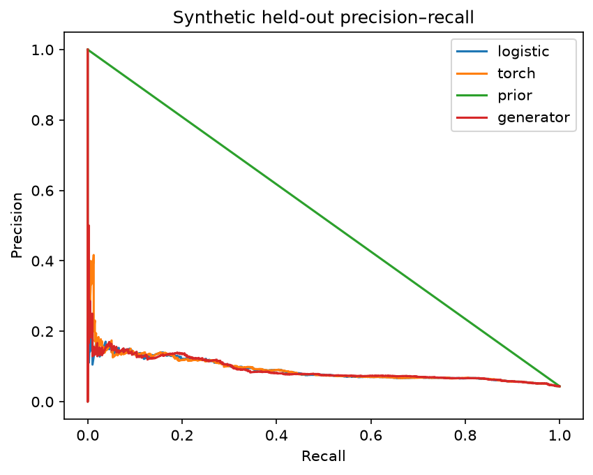
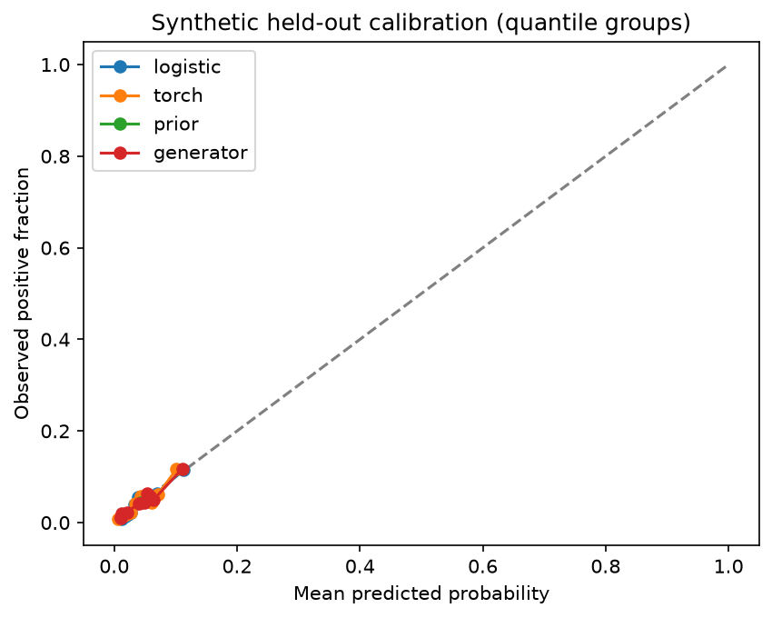

# Synthetic-risk evaluation

No real fraud detection claim. Selection was frozen before test.

| Candidate | AP | Precision | Recall | F1 | Brier |
| --- | --- | --- | --- | --- | --- |
| logistic | 0.09061000120467542 | 0.13059033989266547 | 0.1848101265822785 | 0.1530398322851153 | 0.04112307266235525 |
| torch | 0.09366838968126504 | 0.12248322147651007 | 0.1848101265822785 | 0.14732593340060546 | 0.0410938182231906 |
| prior | 0.04388888888888889 | None | 0.0 | 0.0 | 0.041962655895691606 |
| generator | 0.09178707231357508 | None | 0.0 | 0.0 | 0.04101958237890543 |

Selected: logistic; eligible: True.

See metrics.json for threshold-0.5 metrics, trapezoidal PR-AUC, log loss, calibration counts, sample support, latency and environment.

The constant-score reference's trapezoidal PR-AUC is 0.52194 because interpolation connects the PR endpoint to the single operating point. It must not be interpreted as superior ranking: its AP is only the test prevalence, 0.04389. AP is the selection metric.

The MLP's validation AP exceeded logistic regression by less than the predefined 0.01 absolute margin. Logistic regression was frozen as the selected candidate before the final test. The test ranking does not change that decision. Precision and recall describe synthetic labels only; there is no real-fraud claim. No recalibration was fitted.

Calibration group counts and probabilities, global/currency prevalence and complete split support are in metrics.json. Export parity is checked against each original in-memory candidate, not merely between two reloads. The model files remain local under artifacts/m1; bundle-manifest.json is release metadata, not a standalone loadable bundle.
